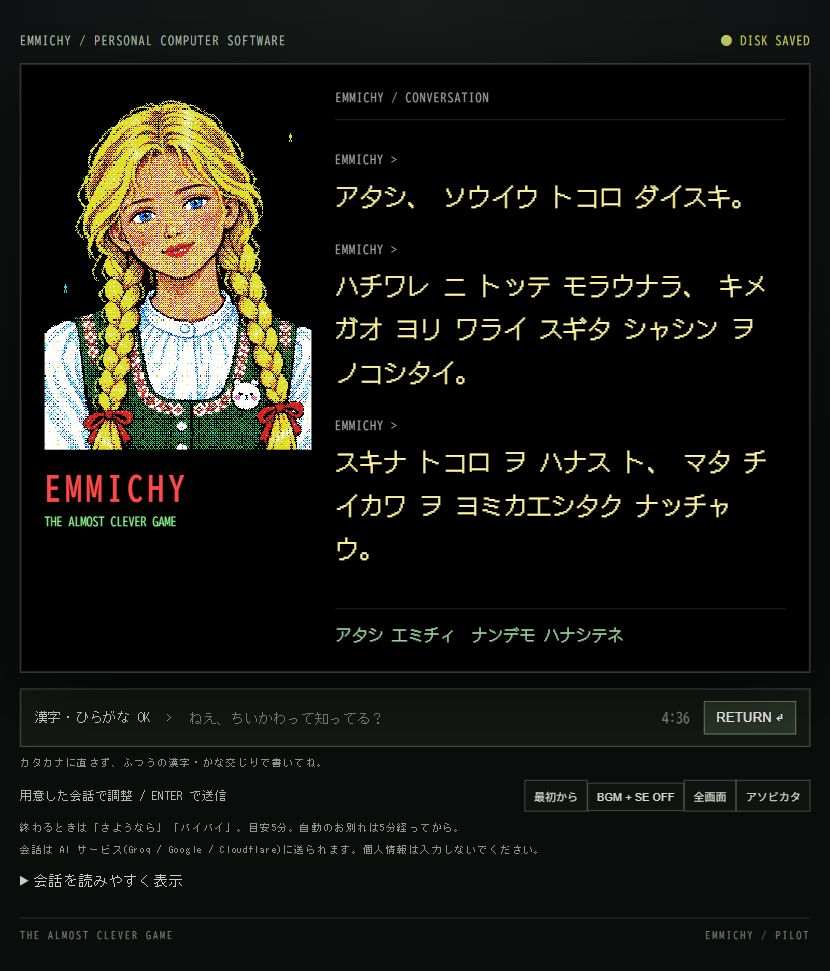

# ちいかわ中心パイロット候補 — 2026-10-12

追記：ユーザーの許可により公開済み。[公開版を遊ぶ](https://mukkii-game.github.io/emmichy/)。「最初から」を選んで試遊する。frontend PR28／Pages38170960518、backend PR15／Deploy38170890200が成功。配信25ファイルが候補と一致し、中継のhealthも正常。根拠は `public-chiikawa-pilot-20261012.json`。追加のLLM通信はせず、人間の試遊を待つ。以下は公開前の候補作成・検証の記録。

ローカルで人間の試遊に渡せる候補を作成。runtime `20261012-chii1`、両リポジトリの作業ブランチは `codex/chiikawa-dialogue-20261011`。公開・マージ・デプロイは未実施。公開版は従来の `20261010-llm2` のまま。公開LLMを含む最終候補全体の試遊は、候補反映の許可後に行う。

コード候補：[frontend PR28](https://github.com/mukkii-game/emmichy/pull/28) の `7d975cbf1430d7d21feb01476dc85dd43589b3db`、[backend PR15](https://github.com/mukkii-game/game-llm/pull/15) の `7a9df963df168cb43ff4f4ea2621367d0106b629`。いずれもレビュー用ドラフト。後続の記録コミットはこの候補識別だけを追記する。

## 会話の変更

良いLLM返答を優先し、ブラウザの一か所で本文の補修を判断する。中継と画面で二重に別の定型文へ置き換えない。同じキャラを深める返答や具体的な質問を残し、固有名詞の個数やLLM／DBの比率を強制しない。

モデルへは漢字かな交じりの入力と、実際に話した本文の履歴を渡す。汎用の相づちは画面に残すが本文履歴から除く。まだ表示していない続きも渡さない。本文履歴は最大20件・6000文字。名前反応の750msの間にも通信を進め、2秒／5秒の待機表現、8秒のクライアント上限を維持。中継は資料取得を含む7.2秒の予算で、各providerは最大3.5秒、Groq→Gemini→Workers。429でそのプレイ中の追加試行を停止する。無料枠で毎回成功する保証はない。

日常の写真・甘い物・勉強・贈り物などから、ちいかわへの接点を探す。質問と訂正を先に受け止め、明示された一人を深める。話題の拒否・深刻な相談、本人設定、半額王NGを維持。文の分割、約1.5〜2秒の間、入力中・下書き・IMEでの停止は共通の表示処理を使う。

## 実際の改善例

以下は用意した会話による模擬試遊の再生。新しい実LLMの発言ではない。

| 入力・状況 | 改善前 | 改善後の抜粋 |
|---|---|---|
| 誰がいちばん好き？ | 島編の一般説明へ逸れる | 「アタシ、ハチワレの気遣いに弱いの」「一番って聞かれると、みんな浮かんで迷っちゃう」 |
| ちいかわ本人の好きなところ | ハチワレ、うさぎへ逸れる | 「ちいかわ本人の、泣いても一生懸命なところが好き」 |
| プリンを買って写真を撮った | 「あなたはどうしたいの？」 | ごほうびへの喜び→ラッコの甘党への連想 |
| 他の漫画はやめて、ちいかわの小さな幸せを話したい | 「別の話にしよう」 | 「ちいかわの小さな幸せの話、しよう！」 |

実LLMで採取した「ハチワレが空を見てヤハと言うシーン」は根拠がなく、採用しない。保存した出力の再生ではその文を除き、元の感想と、写真への本人の好みを残す。別の実出力の「カメラを構えてニコニコする瞬間」も同様に処理した。

## 収集の土台と分担

- 認識辞書：既存182語。単語を拾えることと、場面を正しく説明できることは別。
- 関係データ：25件。事実、人物関係、日常の連想、本人の創作の感想、URL、確認日、ネタバレ、禁止する推論を分離。会話には関連する上位2件程度を渡す。
- 公式アニメ目次：354話の番号・題名を取得。本文や場面の検証済み件数ではない。目次から展開を補完しない。
- 最新漫画：公式本文を取得できず未確認。9月30日の報道を10月12日の最新展開として使わない。

「プリン→甘い物→ラッコ」は創作の連想。「ラッコは甘党」が確認対象であり、「ラッコがプリンを食べた場面」を新しい事実にしない。映画と漫画とアニメの範囲、島二郎の店のメニューと調理担当者も区別する。

Sol／Directorが関係設計と矛盾を検品し、Lunaは指定資料から定型項目を抽出。Pythonは形式・重複・日付・出典欠落を検査する。GitHub Actionsは手動検査だけで、自動収集・自動採用・モデル通信はしない。Gemini／Claudeに渡せる[収集依頼書](chiikawa-research-brief.md)を作成済み。今回は両者を利用していない。全資料を毎ターンLLMへ送らない。

## 検証結果

| 種類 | 結果と範囲 |
|---|---|
| ローカル自動テスト | frontend 171/171、backend 51/51成功。記憶、実際の表示後の保存、訂正、良いLLM本文の保持、入力停止、429、時間予算を含む |
| 知識の機械検査 | 関係25件に形式エラーなし。重複・出典欠落・不正日付・未確認最新話の4つの異常を検出。意味の正しさの証明ではない |
| 仮想プレイヤー | Sol 6.1 mediumを明示指定、1人・6送信。実アプリ、模擬DOM・仮想時計、外部通信なし。3つの失敗を修正し同じ入力を再生 |
| 実ブラウザ | オフラインモードで初対面／5:00、短い文の表示、ハチワレの写真への返答を確認。下書き中約42秒は続きが出ず、消すと再開。音OFF、音量の主観評価は含まない |
| 実LLM | 中継の未公開候補 `2c9cfb0` で最大3試行。Groqの返答2件（中継試験全体739ms／560ms）、3回目HTTP429で停止。これは実ユーザーの回線・ブラウザ込みの時間ではない |
| 実LLM取得後の修正 | 新しい場面を作らない指示と出力補修、関係データを追加。実出力2件をローカル再生。429後の追加通信なし。最終版での新規生成品質は未確認 |
| 人間評価 | 未実施 |

実LLM試験の[GitHub実行記録](https://github.com/mukkii-game/game-llm/actions/runs/38131712099)ではdeployがスキップされた。新しいfrontend知識検査workflowは作成済みだが、GitHub上の実行は未実施。

実装補助と最終コード確認はLuna medium、公式資料の抽出・検品はLuna high、中継改修と限定主観評価はSol 6.1 mediumを明示指定。Director・実装統合・最終判断はこのセッション。新しいWork、Relay、有料サービスは追加していない。

## 残る問題と試遊

場面の補修は「シーン」「場面」や台詞の帰属などを使う限定的な判定であり、全ての誤情報を意味で検出できる仕組みではない。正しい場面の言い換えを抑えたり、別の書き方の誤りを見逃す可能性がある。関係25件は最初の土台で、名場面・映画の詳細・最新漫画の網羅は未完了。無料枠の429も残る。

このPCの[ローカル試遊](http://127.0.0.1:1985/?nollm=1)は通信なしの会話候補。最初からを選び、ふつうの漢字かな交じりで約5分話す。「ハチワレの写真が好き」「その話を続けて」「今日はプリンを食べた」などを試し、途中で入力を始める。LLM込みの候補を公開URLで試すには、frontendのpilotブランチとbackendの公開反映の許可が必要。

証拠：`pilot-chiikawa-20261011-player.json`／`-player-review.md`／`-replay.json`／`-grounded-replay.json`／`-live/emmichy-quality-check.json`。再生は `node scripts/replay-chiikawa-pilot.mjs`、機械検査は `python scripts/check-chiikawa-knowledge.py --self-test`。いずれも実LLM通信なし。
