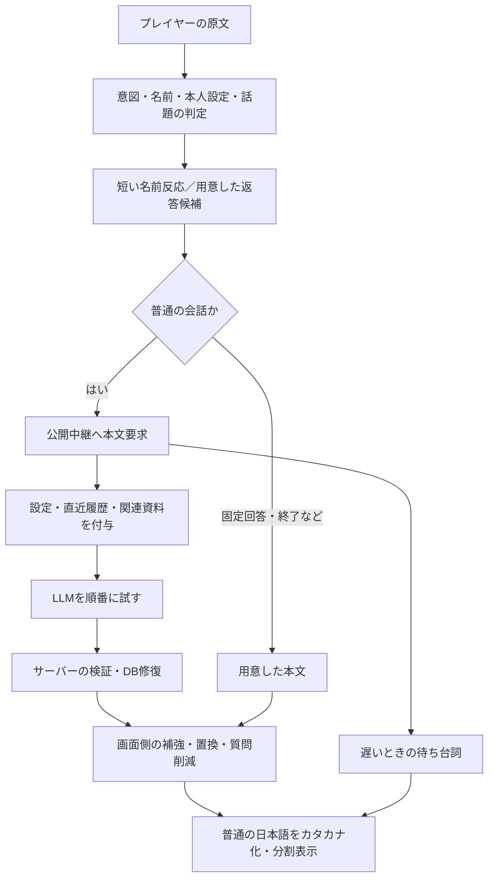

# Emmichy：会話の仕組み・他作品調査・改善案

2026-10-11。ユーザーの①〜④への回答。Webで気軽に遊べること、可能なら無料LLMで運営することを前提とする。これは設計レビューであり、新仕様の採用・実装・公開ではない。

今回の作業はコード確認、公開資料調査、通信を使わない合成例による再現。ゲームLLM通信0回、追加の判定API・有料サービス・サブエージェント0。外部作品を実際にプレイして品質や速度を測った報告ではない。

## 2026-10-11 追加ディレクション（以下の提案より優先）

ユーザーは、パイロットでえみちいを好きになってもらうため、ちいかわの話題と短い口癖をできるだけ挟むことを最優先テーマとして採用した。他のオタクネタの優先順位は下げてよい。音・食べ物・感情・行動などから積極的につなぎ、本人の興奮と感想を出す。質問への返答と訂正の受け止め、明確な拒否や深刻な相談は保つ。原作の事実は作らない。このテーマの強さを一般的な雑談の均等さへ薄めない。

次の依頼は設計レビューだけで終えず、このセッションで実装、試遊、改善まで進め、遊べる候補ができた段階でユーザーへ試遊をお願いする。Astraに切り替える場合も同じセッションを使い、実装のための別Workや自動Relayは作らない。モデルを再度切り替えることを必須の中断点にはしない。今回の追記自体は実行コードを変更していない。

## 1. このセッションとモデル

アプリの記録では、この「Emmichy開発work」は `kind=codex`、`hostId=local`、作業場所 `E:\ゲーム企画\Emmy`。タイトルのworkという語と、ChatGPTのWork製品の種別は別。現在はこのPCのファイルを扱うローカルCodexセッションである。

本件はコード・会話ログ・画面の挙動を照合する作業なので、今の場所が適している。文章だけを評価するChatGPT Workへ移し直す必要はない。開発セッションのモデルと、ゲームのプレイヤーに返すLLMは別である。

推奨は、現状調査と再現資料の作成をSol 6.1の極高で完了し、次の「会話設計をどう整理するか」というレビューだけ同じセッションでAstraに切り替えること。高〜極高からでよく、ウルトラを必須とする証拠はない。Astraのレビュー後、実装・回帰確認はSolへ戻す。Claudeは同じ資料への独立した批評として使えるが、今回の作品でどちらが良いかは未比較。全履歴を複数モデルへ繰り返し渡す方法は推奨しない。

この使い分けは私の判断。公式ではAstraを曖昧な問題・深い分析、Solを時間と費用も重視する複雑な作業向けとしている。[OpenAIのモデル選択ガイド](https://developers.openai.com/api/docs/guides/model-selection)

## 2. 現在の仕組み：実装から確認した事実

- 最新入力は入力欄の漢字かな交じりの原文。ユーザーがカタカナで入力すればその原文を送る。英訳せず、表示用カタカナへ変換してからも送らない。
- キャラの本文は普通の日本語で生成・保存し、画面に出すときにカタカナ化・分かち書きする。古い履歴にカタカナ文が残る場合はある。
- サーバーは本人設定、演技、出力規則、関連資料、直近10発言、最新入力を渡す。10往復ではない。名前・作品・資料IDの記憶と、限られた共有素材も別途参照する。全プレイの全文を渡してはいない。
- 通常会話では毎ターンLLMを試す。挨拶・別れ・計算・記憶回答・性的な話の転換などは即答を優先。固定の出身も即答。通信休止中はDBへ進む。
- 短い名前反応は約0.75秒。その後の通信中に約2秒で相づち、約5秒で関連する短い待ち台詞。通信予算は8秒で、名前演出や文字送りの時間は別。
- リポジトリの呼び先はGemini→Groq→Workers AI。環境変数による順序の上書きは可能。設定上のモデルは `gemini-flash-latest`、`openai/gpt-oss-120b`、`@cf/google/gemma-4-26b-a4b-it`。Geminiのlatestが具体的に何へ解決されたかは今回測定していない。
- 各providerは全文の取得を2.5秒まで待つ。必要な未知の名前では、その前にWikipediaの検索スニペットを最大1.6秒で確認する場合がある。現在は全文JSONを受け取る方式で、本文のストリーミングはない。
- 通信エラー後は約60秒休止。画面がHTTP429を受けた場合はそのプレイで停止。ただしprovider側429は中継で捕捉され、次を試して最終502になる経路もある。両者を同じ429として数えることはできない。
- 返答の文や節を時間差で出す。普通の次文は4秒／5秒、同じ文の節は1.5秒、興奮したちいかわ話は2秒。入力・IME・未送信の下書きがある間は止める。新しい送信で古い続きは捨てる。
- 続きが終わった後の沈黙では短い本人の話、長くちいかわが出なければ話題のリマインダーもある。終了は5分を目安に最低10往復などの条件を併用するため、時計だけの厳密な5分終了ではない。

主な根拠：`src/app.js`、`chat.js`、`balance.js`、`continuation.js`、`session.js`、中継の `games/emmichy.js`、`src/index.js`、`providers.js`、`decide.js`。公開フロントはPR27の統合 `a7b42827e308bff73f9147da9b935ccfdcbd5051`。今回は最新pilotが同じ統合であることをGitHubでも確認した。

## 3. 待ち時間・履歴・複数候補・判定器への回答

### 速くできるか

改善余地はあるが、ChatGPTの会話モードと同じ速度を無料APIで保証できるとは言わない。現在の全体時間は、モデルの計算だけでなく、通信、検索、順番に試す失敗、全文待ち、検証、名前の演出、文字送りを含む。成功ログの3,653ms／6,032msだけでは、どれが何秒か分離できない。

15文字の「今日は散歩でパン屋を見つけたよ」を、履歴なしで中継の現行組み立て処理へ渡したところ、system本文だけで6,780文字になった。これは文字数であり、トークン数や実課金額ではない。長さだけを原因と断定しないが、重複した規則を整理する理由になる。

最初に試す案は、(1)一回の会話で使う主モデルを安定させる、(2)通常入力で外部検索をしない、(3)設定を短くし関連資料を少数だけ渡す、(4)対応モデルの思考量を適切に下げる、(5)最初の完結した短文から表示する、の順。latestエイリアスの実体を確認せずに世代の違う思考設定を付けない。出力上限を下げるだけでは、思考中に上限へ達して本文が空になるモデルもある。[Geminiの思考設定](https://ai.google.dev/gemini-api/docs/generate-content/thinking)

全文待ちと途中配信は別の方式であり、Groqも途中配信による体感待ち時間の改善を説明している。[Groqの速度改善ガイド](https://console.groq.com/docs/production-readiness/optimizing-latency)、[Geminiの生成・途中配信](https://ai.google.dev/gemini-api/docs/generate-content/text-generation)

ただし本作では、今の「全文を読んで別の文章へ置換」と途中表示をそのまま併用すると、後から画面を書き換える不自然さが戻る。短文を一つバッファして確認し、表示した文は撤回・差し替えず、残りの文へ進む方式が必要。途中配信後に別providerへ切り替えて最初からしゃべり直すことも避ける。

待ち反応は少し残す。ただし毎回「ウンウン→別の短い話→本文」にはしない。すでに名前へ反応したなら十分な場合がある。長い待ち台詞が本文の前に勝手な事実を増やさないよう、短い受け止めか表情に限定する案がよい。

### 全履歴・フィラー

5分のプレイなら、直近の実質的な会話を広く渡す価値がある。全ブラウザ履歴・過去の全プレイを無制限に送る案ではない。提案は「今回の実質的なやり取り＋現在の対象＋訂正＋直前にした質問」。長い場合だけ、古い部分を短い要約にする。

同じ4往復の合成履歴に各2個の待ち台詞を入れた現行処理では、LLMの直近10発言に残るプレイヤー発言は2件。一般的な待ち台詞を除くと4件全部残った。`mechanics-audit-20261011.json`に入力と送信履歴を保存した。

「ウンウン」など意味の薄いフィラーはモデル用履歴から除くか、一つのターンへまとめる。画面・書き出しの記録は残す。一方「これ、アタシが作ったの」や質問・訂正を一律に消すと、次の「それ」「なぜ？」が分からなくなる。発言の種類を保存し、本文・質問・事実の自己開示と純粋な待ち演出を区別する。

### 複数の答えから選ぶ

可能だが、毎ターンの2〜3並列生成と追加判定は無料枠・遅延に不利。候補すべての生成完了を待てば遅くなる。同じモデルの候補が同じ誤りを含むこともある。

まずは「生成1本文＋既存DBの予備候補」にする。短い複数候補を同じ一回の要求で作る案は、沈黙時の次の話題や重要な一場面などに限定して比較する余地があるが、出力量と自己判定の偏りは増える。最初の改修には必須にしない。

### Jevのような判定器

使い道は、質問／訂正／話題拒否／自己紹介／好きな対象、など少数の判定。面白さや原作の正確さを保証する判定器として扱わない。Jevは状態と型付き質問から構造化された答えを返すモデルである。[TypeSafeの公式説明](https://docs.typesafe.ai/introduction)

本プロジェクトの中継には、同じ用途のCloudflare Clef判定窓口と `talk` の意図・熱量の質問がすでにある。しかし現行フロントはこの窓口を呼んでおらず、会話の実際の判別は主にローカル規則。Clefが全体を判断しているわけではない。[CloudflareのClef説明](https://developers.cloudflare.com/workers-ai/models/clef-flash/)

導入するなら、まず曖昧な質問・訂正・拒否の少数例で日本語精度を検証する。生成の前に毎回別通信を直列追加すると待ちが増えるので、明白な名前・終了はローカルで処理し、必要な場合だけ使う。自信の低い判定で話題を勝手に変更しない。今回、新APIの追加や判定通信は行っていない。

## 4. ルール・キャラ・質問・DB

後付け規則の重なりは確認できる。LLMの内部が混乱したと証明したわけではなく、アプリ側にも競合する介入がある。

ローカル再現では、「ちいかわの話して」に対するハチワレ中心の86文字の合成本文が、3つの別のDB話題へ全置換された。理由は、話題への一般の誘いで、別のちいかわ固有名詞が2つ以上あるかなどを判定するため。一つのキャラの話を自然に深める本文を、それだけで不合格にするのは見直したい。合成例を実LLMの失敗として数えない。

もう一例では、直前2発言に質問があるだけで「パン屋を見つけたんだね。何パンを買ったの？」の後半が削られた。質問連発を抑える目的はよいが、今回の意味を見ずに必要な問いまで消す条件は荒い。質問の頻度は生成前の今回の行動選択で調整し、完成した文章を機械的に削ることを減らす。

整理案は優先順を「訂正・拒否・終了 → いま相手が言ったこと／前の質問への回答 → 本人設定と確認済み知識 → キャラの好み・癖 → 表示演出」にする。本文の内容を決める処理は一つにし、同じ本文をサーバーとフロントで別々に大きく書き換えない。

**狭めるのは自由入力ではなく、彼女の得意分野と5分の遊びの目的。** 「何でも入力できるが、何でも解説する先生ではない。ちいかわに詳しく、日本語を教わりたがる、少し話を脱線させる子」が合う。出身・訪日歴などの本人設定は保持するが、まだ設定していない経験まで増やさない。

追加ディレクションにより、ちいかわへの積極的な脱線はパイロットの中心として合意された。相手の話を受け止め、感情・行動・好き嫌いの共通点や似た音から、嬉しそうにちいかわへつなぐ。話題の頻度だけでなく、本人の感想、会話の連続性、相手が返しやすい短さで評価する。明確な拒否や訂正を拾い、同じ接続文の反復を避ける。

範囲の狭い質問は有効。例：「ちいかわで、誰が好き？」「映画、笑うのと泣くの、今日はどっち？」「日本語で覚えた言葉、一つ教えて」。会話状態に「今は好きなキャラを聞いている」と持てば、「ハチワレかな」は回答として扱え、無関係な人物へ飛びにくい。自由入力を維持し、答えにくい相手には2〜3個の小さな任意選択肢を添える。質問の連続をゲームの進行にしない。

語尾を削って単語を得る処理では、「好きじゃない」「ハチワレよりうさぎ」まで削って意味を変えない。原文・対象・肯定否定・比較・現在の質問への回答を区別し、必要なら軽量判定器を使う。

DBは役に立っている。役目を分けるべきである。

|DBの種類|残す役目|減らす役目|
|---|---|---|
|本人設定|経歴・好み・胸の自作飾りの一貫性|毎回の長い自己紹介|
|名前・別名|名前反応、表記揺れ、直前の質問の回答候補|名前を見ただけで本文の話題を決める|
|作品の事実・出典|LLMに渡す少数の根拠、誤り防止|未確認の場面を埋める断定|
|本人の感想・反応例|口調の見本、通信失敗時の続き|正常なLLM本文の無条件置換|
|開幕・終了・短い反応|通信なしの安定した進行|同じ挨拶・相づちの連発|

LLMにキャラ条件だけを渡すと、細かな原作知識や本人設定の維持をモデルの記憶に頼ることになる。自分で整理した小さな出典付きDBを参照する方が、この作品の要望に合う。全文を巨大なプロンプトへ入れず、今の話題へ合う少数の資料を取り出す。

WikipediaのURLを一つ指示に書くだけでは、現行APIがそのページを読んだことにはならない。必要な部分を取得する処理が要る。本作には限定的な検索スニペット取得があるが、原作の全場面を検証する仕組みではない。資料は開発時に確認して保存・更新し、会話中の毎回検索を避ける。作者・公式公開資料・Wikipediaのどの根拠かを残し、長い原文転載ではなく短い事実と本人の感想を分ける。

## 5. 他作品から何を採るか

|作品|公開資料から確認した特徴|Emmichyへの設計上の示唆（私の判断）|
|---|---|---|
|Emmy／Emmy II|文字入力で画面の人物と会話する。工画堂の関係者は、初代の作り直しに不満があり自分たちのアルゴリズムでIIを作った経緯を説明している。|絵と短い反応で「この人物がそこにいる」感覚を保つ。昔の偶然の会話成立を、LLMより優先する規則として再現する必要はない。|
|Microsoftのりんな|2020年の説明は言語生成と知識探索を組み合わせ、相づち中心から具体的な内容を伴う会話への改善を説明する。|フィラーで長く続いた回数ではなく、相手の話を具体的に拾ったかを見る。DBの知識を生成へ渡す役割分担が参考になる。|
|RyzaChat:AI|会話で冒険し、採集・調合した持ち物、場所、クエストなどの状態が画面と次の会話へ残る。|自由会話に小さな共通の目的と結果を持たせる。本作はRPGへ膨らませず、「一つ教わった言葉」「共有した好きなキャラ」を終わりに回収する。|
|妹に運転を教える|音声で運転を教えるという明確な役割。開発者はクラウドの遅れをローカル補助で支える設計と、モデル切り替え時の人格の違いを述べる。|本文と即時反応の役割を分ける。代替モデルを増やすだけでは人格の安定は解決しない。Webとスマホでは重いローカルLLMを必須にしない。|

出典：[Emmyについての工画堂関係者インタビュー](https://news.denfaminicogamer.jp/interview/211206b)、[Microsoftによるりんなの会話エンジン説明](https://news.microsoft.com/ja-jp/2020/06/15/200615-ai-chatbot-rinna/)、[RyzaChat公式](https://ryzachat-ai.go-spiral.ai/)、[妹の運転ゲーム・開発者インタビュー](https://www.gamespark.jp/article/2026/10/09/173435.html)、[同作のSteam開発者説明](https://store.steampowered.com/app/3948460/Teach_My_Little_Sister_How_To_Drive/?l=japanese)。

Emmyシリーズの原プログラム内部を今回復元したわけではない。りんなの歴史的資料を現行サービスの内部仕様だとも扱わない。ライザや妹の内部プロンプトは公開資料から分からない。ユーザーのX投稿は403で本文を直接取得できず、Game*Sparkの関連記事と開発者インタビューを調査した。投稿そのものがどの記事を指すかは断定しない。

## 6. 問題と解決の優先順位

|優先|問題・証拠|解決案|確認方法|
|---|---|---|---|
|1|画面と中継の双方が本文を置換する。合成ハチワレ本文も全置換された。|本文の判断を一本化し、キャラ補強は生成前の指示へ。置換は明確な誤り・破綻へ限定。|同じ5〜8場面で元本文／編集後／表示を並べる。|
|1|サーバーでDBへ修復してもprovider名だけを返す。AI採用数では本文の出所が分からない。|要求回数、生成成功、純LLM、混合、DB全置換、表示までを別記録。|既存の合成修復を通して出所が保存されるか。|
|1|10発言の履歴を待ち台詞が消費する。|表示用ログとモデル用の実質会話を分ける。今回の会話・訂正・直前の質問を優先。|合成4往復で全プレイヤー入力が保持されるか。|
|2|全文待ち・順次失敗・長い条件・演出の時間が合わさる。|短い設定、主モデルの安定、思考量確認、短文の途中配信。|検索、最初の本文、生成完了、画面表示を別々に測る。|
|2|2.5秒の全文制限は、本来使える本文まで捨てる可能性。|最初の意味ある短文の期限と全体期限を分ける。|provider別ログで、本当に遅いのか棄却なのかを区別。|
|2|自由会話の目的と、質問への回答先が弱い。|本人の得意分野＋一つ教わる目的、直前の質問の回答状態。|短い名前回答・否定・比較・訂正・話題変更を通す。|
|3|固有名詞・褒め語の単独判定で取り違えやすい。|現話題、対象、質問、否定を先に。曖昧な場合だけ軽量判定。|「好き？」「好きじゃない」「○○より△△」を別に評価。|
|3|細かな分かち書きと時間差表示も読みづらさを作る。|意味の短文・固有名詞の保護・入力中停止を維持し、余計な間を再評価。|全文の日本語とカタカナ画面を並べて人間が読む。|
|3|固定の共有素材だけでは二人だけの話になりにくい。|今回の好きなキャラ・教わった言葉など少数の可変素材を保存。|本人が言っていない体験を足さず終わりに回収できるか。|
|基盤|無料枠はユーザー全体で消費する。provider429が502へ隠れる経路、タイムアウト後も完了する処理がある。|上限を超えたproviderを短時間外す。総量の予算・DB継続・可能なキャンセルを整理。|通信なしの模擬上限／中断テスト。実通信は少数、429で止める。|

これまで修正済みの下書き割込み、出身認識、挨拶、固有名詞表記、音の終了などを撤去する提案ではない。必要な機能を保ちながら、相互作用を減らす。現行155フロント／37中継テストの成功は回帰の証拠であり、会話の面白さや実端末での全動作を承認した数字ではない。

## 7. Web・無料LLMを守るための構成

ブラウザは絵・音・入力・表示・ローカル状態・短い反応を担当。鍵を持つ公開中継が一回の本文生成と少量の根拠を担当。重いモデルのダウンロードやプレイヤー自身のAPIキーを基本条件にしない。

通常は一回の本文要求。入力中の推測生成、多providerの常時並列、全候補の採点、毎回の外部検索は避ける。本人の固定回答と開幕・終了は通信を使わず、通信失敗時もDBで5分の体験を成立させる。良いLLM返答は続け、固定の半々比率は復活させない。

無料枠の存在と、全員へ無制限に提供できることは別。Groqにはモデル別の要求数・トークン数の上限があり、Cloudflareにも日次の無料割当がある。[Groqの上限](https://console.groq.com/docs/rate-limits)、[Cloudflareの無料割当・料金](https://developers.cloudflare.com/workers-ai/platform/pricing/)

一日何人まで無料で遊べるかは、実入力トークン・出力・成功率・再試行・実アカウントの上限を測ってから算出する。今回の6,780文字から人数を推定しない。予算を超えたら課金へ自動移行する案ではなく、DBで続ける上限管理を提案する。

## 8. 次に行う小さな比較

1. 今回の出所と履歴の再現を、文章が書き換わる各段階の記録へつなぐ。
2. 現行を残し、「短い設定＋実質会話履歴＋本文の置換を少なくする」比較版をローカルに作る。
3. 固定5〜8例で、答えているか／直前の話を覚えているか／人格が一貫するか／同じ台詞を繰り返さないかを比べる。
4. その後に小さい実通信比較で、最初の具体的な短文までの時間と本文の質を測る。429で止め、失敗も残す。
5. 人間プレイヤーの確認を受ける。公開は改修結果が具体的になってから、既存の許可範囲と最新指示を確認して扱う。

速度の仮目標は、普通の入力で最初の具体的な短文まで中央値2秒以内・遅い側でも4秒程度。達成済みではなく、モデル・地域・負荷ごとに検証する目標である。フィラーが0.75秒で出たことを「具体的な本文が速い」と数えない。

Astraへ渡すなら、この資料と合成再現JSON、代表失敗5〜8例、SPEC冒頭の新しい優先テーマを渡す。設計を比較してから実装と試遊・改善まで進め、ユーザーに遊んでもらえる候補を作る依頼にする。必要なファイルと最近の関連記録だけ読み、別Workや自動Relayは作らない。
