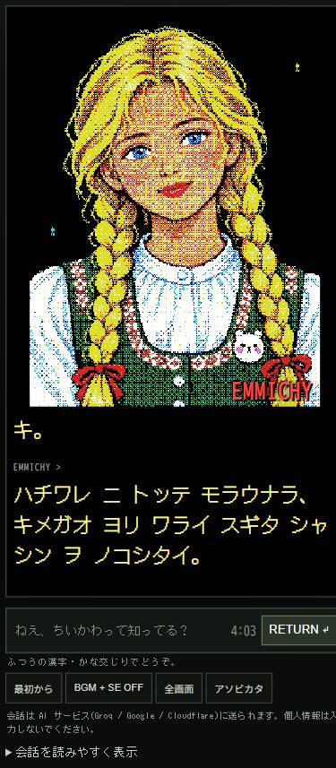

# スマホ縦画面の肖像拡大候補（2026-10-12）

追記：ユーザーの許可で公開済み。[公開版](https://mukkii-game.github.io/emmichy/)へPR29を反映、Pages38193268352が成功。HTML／CSS／appの3ファイルが候補と一致。記録：`public-mobile-layout-20261012.json`。以下は公開前の実装・検証記録。

従来はスマホでも肖像が130px幅で、隣にロゴを置いていた。縦画面では肖像を上部中央に大きく置き、ロゴを右下へ重ねる。絵は画面の高さの約52%を上限として全体を見せ、下に短い会話表示と入力欄を並べる。小さい画面では入力欄が下端に残る。細かい見出し・タグライン・重複する説明は省き、普通の日本語で入力する案内、音・最初から・遊び方、AI送信の案内は残した。

会話開始／送信後のフォーカスでページを自動スクロールさせず、絵の頭が画面外へ押し出される問題も修正。画像の色・ドット・会話処理には変更なし。PCと横向きの既存レイアウトを維持する。

| 縦の画面 | 肖像幅 | 横はみ出し | 入力フォーム下端 |
|---|---:|---|---:|
| 320×568 | 218px | なし | 551px |
| 390×844 | 324px | なし | 728px |
| 430×932 | 358px | なし | 799px |

1280×900のPC表示ではロゴが通常配置、肖像385px幅を維持。390px幅で開始と実アプリのオフライン1送信を確認し、開始／送信後ともページスクロール0、肖像上端は画面内。既存171テスト成功。ブラウザのviewport検証であり、実機Safari/Chromeとソフトキーボードは未確認。実LLM呼び出し・外部AI・サブエージェントなし。

CSS／入口のキャッシュ識別子 `20261012-mobile1`。候補は未公開で、公開試遊版は `20261012-chii1` のまま。新しい候補の公開前確認というユーザー指定に従い、実装・画面確認・PRまで準備して確認する。

証拠：`mobile-layout-20261012.json`、下のスマホ画面、`mobile-layout-20261012-desktop.png`。

