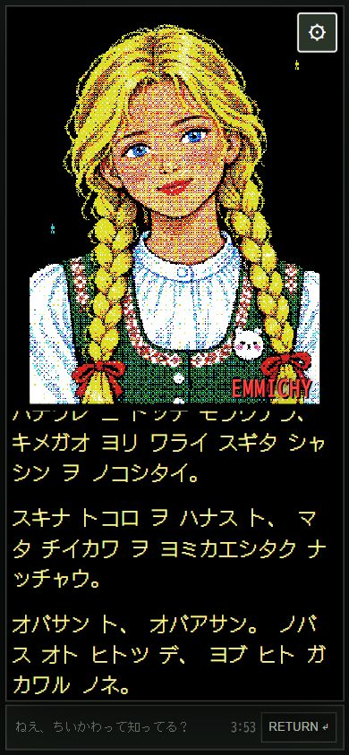

# スマホ会話エリア拡大候補（2026-10-12）

大きな肖像を保ち、文字を小さくせずに会話エリアを広げた。常時表示は肖像、会話、入力欄と残り時間、右上の設定ボタン。最初から、音、全画面、遊び方、入力の案内、AI送信の案内、読みやすい会話表示は設定内へまとめる。設定は閉じるボタン、端のボタン、外側のクリック、Escapeで閉じられる。同じ話者が続く時の重複ラベルも省く。

画面の残り高さを全て会話へ割り当て、ページ全体ではなく会話ログをスクロールする。入力欄は画面の下端。visualViewportの高さ変化に追随し、使える高さが減った時は肖像もその高さに合わせて収める。実機のキーボード挙動は未確認。

| 検証画面 | 肖像幅 | 会話ログの高さ | 文字 | 入力欄下端 |
|---|---:|---:|---:|---:|
| 320×568 | 218px | 185px | 22px | 562px |
| 390×844 | 324px | 318px | 22px | 838px |
| 430×932 | 358px | 360px | 22px | 926px |
| 390×500（使える高さを減らした模擬） | 192px | 153px | 22px | 494px |

390×844の旧ログ高さ194pxから約1.6倍。肖像幅324pxと文字22pxは維持。すべてのスマホ検証で横はみ出し・ページ全体の縦はみ出しなし。1280×900のPCでは従来の横並びと常時表示の操作欄、24pxの会話文字を保持する。

実ブラウザで設定開閉、音OFF、遊び方の開閉、Escapeでの閉鎖、初回、オフライン1送信を確認。171テスト成功。viewportの検証であり、SafariやAndroidの実キーボード試験ではない。外部LLM・サブエージェントなし。公開版はmobile1のまま、入口/CSSの候補識別子は20261012-mobile2。

設定内の操作は `mobile-space-20261012-settings.png`、寸法は `mobile-space-20261012.json`。新候補の公開前確認という既存のユーザー指示により、候補を保存して公開の確認を求める。
